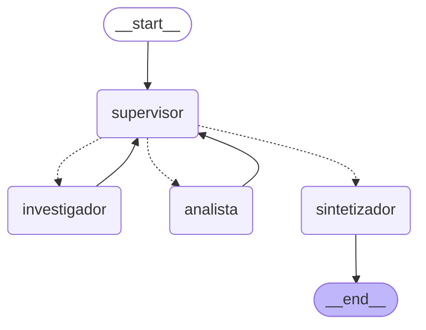

# Módulo 6 — Orquestador multi-agente especializado

Pre-entrega 6 del curso **AI Engineering**. Un orquestador **jerárquico** de análisis e investigación
construido con **LangGraph**: un **supervisor** (router inteligente) delega en dos especialistas —un
**investigador** que busca datos en la documentación y un **analista** que calcula con ellos— valida sus
aportes con una rúbrica y, recién cuando la tarea está completa, un **sintetizador** redacta la respuesta final.

> **Demo del flujo de delegación:** [`demo_orquestador.ipynb`](demo_orquestador.ipynb) (notebook con las
> salidas reales de una ejecución) · traza de referencia en [`trazas/`](trazas/).

## Diagrama del grafo

Generado con `graph.get_graph().draw_mermaid()` (`python main.py --mermaid`; también en [`grafo.mmd`](grafo.mmd)).
Las flechas punteadas son la **arista condicional** del supervisor, que devuelve un `Literal`.



## Estructura

```
modulo-6-orquestador-multiagente/
├── state.py                 # EstadoOrquestador(MessagesState): estado compartido con procedencia
├── agents/
│   ├── research_agent.py    # investigador: BM25 sobre la documentación (listar/buscar)
│   ├── analyst_agent.py     # analista: calcular (seguro), estadisticas, convertir_tiempo
│   └── base.py              # ejecución aislada de un especialista y extracción de resultados
├── supervisor.py            # supervisor: decisión por LLM + rúbrica + reglas de validación
├── graph.py                 # StateGraph: nodos, arista condicional (Literal), sintetizador
├── runner.py                # ejecutar(): corre una solicitud y arma la traza de delegación
├── main.py                  # CLI (consulta de demo, --guardar, --mermaid)
├── demo_orquestador.ipynb   # demo ejecutada: delegación real + reglas de validación
├── trazas/                  # traza_ejemplo.json / .log (ejecución de referencia)
├── data/                    # documentos que consulta el investigador (manual de Nubra Cloud, Módulo 3)
├── tests/                   # 26 tests sin red ni API keys
└── grafo.mmd · .env.example · requirements.txt · requirements-dev.txt
```

## Cómo correrlo

Requiere **Python 3.12**.

```bash
cd modulo-6-orquestador-multiagente
py -3.12 -m venv .venv
.venv\Scripts\activate          # Linux/Mac: source .venv/bin/activate
pip install -r requirements.txt
copy .env.example .env          # Linux/Mac: cp .env.example .env
# editá .env: ANTHROPIC_API_KEY (u OPENAI_API_KEY + LLM_PROVIDER=openai)

python main.py                  # corre la consulta de demostración
python main.py "tu consulta"    # una consulta propia
python main.py --guardar        # además guarda trazas/traza_ejemplo.{json,log}
python main.py --mermaid        # imprime el diagrama (no necesita API key)
pytest                          # 26 tests (pip install -r requirements-dev.txt)
```

Las keys viven solo en `.env` (ignorado por git).

## Por qué esta topología

**Jerárquica con un supervisor central**, y no una red de agentes que se hablan entre sí:

- La tarea tiene **dependencias de datos** (el analista no puede calcular sin lo que investigó el
  investigador). Un coordinador central ve todo el estado y decide el orden; en una red peer-to-peer cada
  agente tendría que adivinarlo.
- Hay un **único punto de decisión y de parada**, lo que permite validar los aportes y garantizar que el
  flujo termina. Con agentes que se invocan entre sí es mucho más difícil acotar los bucles.
- Los especialistas son **intercambiables y acotados**: cada uno tiene solo las herramientas de su rol
  (el investigador no puede calcular; el analista no puede buscar), lo que reduce errores y costo.
- El supervisor es un **router por LLM** (entiende la solicitud y la descompone) pero sus decisiones pasan
  por reglas en código: es inteligente donde hace falta y determinista donde importa.

Costo: el supervisor es un cuello de botella secuencial y cada vuelta suma una llamada al LLM. Para
solicitudes de dos dominios es un precio razonable por la trazabilidad y el control.

## Estado compartido (`state.py`)

`EstadoOrquestador` hereda de `MessagesState` y agrega campos con reducer `operator.add` (los nodos
devuelven solo lo nuevo; nada se pisa):

| Campo | Para qué |
|---|---|
| `messages` | historial compartido legible (cada aporte se agrega con el nombre del agente) |
| `contribuciones` | **quién aportó qué**: agente, versión, decisión que lo originó, instrucción recibida, contenido, herramientas usadas, fuentes y si falló |
| `decisiones` | cada decisión del supervisor con su razón y la regla de validación que la corrigió, si hubo |
| `next_agent` / `instruccion_actual` | a quién enrutar y con qué instrucción específica |
| `pasos` | contador de decisiones (criterio anti-bucle) |
| `advertencias` | límites alcanzados, aportes sin verificar, especialistas caídos |
| `task_completed` / `respuesta_final` | cierre de la tarea |

Como los aportes son **versionados y acumulativos**, un refinamiento no borra lo anterior: el analista y el
sintetizador reciben **todos** los aportes válidos (un refinamiento puede *complementar* y no solo *reemplazar*),
y si un refinamiento falla se conserva el aporte válido previo.

## Flujo de supervisión y validación

1. **Descomposición.** Antes de la primera instrucción, el supervisor identifica *todos* los datos que harán
   falta para los cálculos y se los pide juntos al investigador.
2. **Rúbrica en el prompt del supervisor** (5 criterios): cobertura, fundamento (fuentes citadas), cómputo
   verificado (cifras salidas de una herramienta), consistencia y entradas completas (nada supuesto).
3. **Refinamiento.** Si un aporte incumple la rúbrica, el supervisor reenvía al *mismo* especialista indicando
   exactamente qué corregir (máximo un refinamiento por especialista).
4. **Reglas en código** (`aplicar_reglas`) validan cada decisión del LLM antes de ejecutarla:

| Regla | Qué impide |
|---|---|
| R1 | más de `MAX_PASOS` (6) decisiones por solicitud → cierra |
| R2 | enviar al analista sin que el investigador haya aportado datos |
| R3 | que un especialista intervenga más de 2 veces (intento + 1 refinamiento) |
| R4 | cerrar sin investigación y análisis, con investigación sin fuentes, o con análisis que no usó herramientas de cálculo |
| R0 | si el LLM del supervisor falla, sigue por una ruta de emergencia investigador → analista → cierre |

   Las reglas solo pueden **redirigir** hacia un especialista con margen o hacia el sintetizador, de modo que
   el flujo siempre termina. Además, el grafo corre con `recursion_limit = 25`.
5. **Síntesis.** El sintetizador redacta usando exclusivamente los aportes, sin recalcular, atribuyendo
   datos al investigador y cálculos al analista, y señalando contradicciones si las hay.

## Cómo se manejan los conflictos entre agentes

- **Dato faltante o suposición del analista:** el analista tiene prohibido suponer; si falta un dato lo avisa.
  El supervisor, a su vez, devuelve la tarea al investigador antes de permitir el cálculo.
- **Aporte que incumple la rúbrica** (sin fuentes, sin cálculo verificado): se pide un refinamiento
  dirigido; si tras el segundo intento sigue sin cumplir, el sistema cierra con una **advertencia explícita** en
  vez de afirmar algo no verificado.
- **Aportes contradictorios:** la rúbrica incluye consistencia; el sintetizador no elige en silencio, lo señala.
- **Supervisor que se obstina** (pide siempre lo mismo) o **agente que falla:** topes por especialista y por
  solicitud, y ruta de emergencia; un especialista caído no tumba el sistema (queda registrado como aporte
  `fallida` y como advertencia).
- **Contaminación de contexto:** los especialistas **no ven la conversación**. El investigador recibe solo
  la instrucción del supervisor; el analista, esa instrucción más los aportes del investigador que necesita.

## Demostración

Consulta de demostración (necesita dos dominios: investigar y calcular):

> Según nuestra documentación de respuesta a incidentes, ¿cuál es el tiempo de respuesta de cada nivel de
> severidad (SEV1, SEV2 y SEV3)? Con esos datos calculá: (a) cuántas actualizaciones de estado debería
> publicar el equipo durante un incidente SEV1 que dura lo mismo que el RTO de las bases de datos de
> producción, y (b) el tiempo de respuesta total acumulado si en un mes ocurren 1 SEV1, 2 SEV2 y 3 SEV3.

Respuesta correcta esperada (de los documentos): SEV1/SEV2/SEV3 = 5 min / 15 min / 4 h; RTO = 2 h y
actualización cada 15 min en SEV1 → **8 actualizaciones**; total = 5 + 2·15 + 3·240 = **755 minutos**.

**Traza de referencia** ([`trazas/traza_ejemplo.log`](trazas/traza_ejemplo.log), `claude-haiku-4-5`, 53 s):

```
FLUJO: supervisor -> investigador -> supervisor -> analista -> supervisor -> investigador -> supervisor -> analista -> supervisor -> sintetizador

[01] SUPERVISOR   -> investigador   (pide tiempos de respuesta, RTO y frecuencia de actualización)
[02] INVESTIGADOR v1  herramientas=[buscar_documentacion x3]  fuentes=[02_respuesta_a_incidentes.md#2. Niveles de severidad, 01_politica_de_backups.md#4. Objetivos de recuperación]
[03] SUPERVISOR   -> analista
[04] ANALISTA     v1  herramientas=[convertir_tiempo, calcular, ...]  -> calculó (b) = 755 min y NO calculó (a): no había frecuencia documentada
[05] SUPERVISOR   -> investigador   (detecta la entrada faltante: la frecuencia de actualización)
[06] INVESTIGADOR v2  -> "SEV1: cada 15 minutos" (02_respuesta_a_incidentes.md#2. Niveles de severidad)
[07] SUPERVISOR   -> analista
[08] ANALISTA     v2  -> 120 min ÷ 15 min = 8 actualizaciones
[09] SUPERVISOR   -> sintetizador   (rúbrica cumplida en los 5 criterios)
[10] SINTETIZADOR respuesta final: (a) 8 actualizaciones, (b) 755 minutos, con fuentes y atribución
```

Esa corrida muestra la fase de **refinamiento antes del `END`**: el analista se negó a inventar un dato, el
supervisor lo detectó con la rúbrica y mandó a investigarlo, y solo entonces cerró. El notebook
[`demo_orquestador.ipynb`](demo_orquestador.ipynb) contiene una ejecución independiente (el LLM no es
determinista: allí el supervisor pidió todos los datos de entrada de una vez y el flujo fue más corto) y una
segunda parte **sin LLM** que muestra las reglas R2, R3 y R4 actuando sobre el grafo real.

### Qué se encontró probando con un LLM real (y se corrigió)

Los tests con piezas falsas no alcanzaban; las primeras ejecuciones reales destaparon cuatro defectos:

1. El supervisor metió un **supuesto propio** en la instrucción al analista («actualización cada 5 minutos»)
   que no estaba en los documentos → dio 25 en vez de 8. Se agregó el criterio «entradas completas» a la
   rúbrica y la regla de descomponer la solicitud antes de pedir datos.
2. Un refinamiento fallido **pisaba** el aporte válido anterior y el sintetizador recalculaba por su cuenta
   (y se atribuía los cálculos). Ahora `ultima_contribucion` ignora los intentos fallidos y el sintetizador
   tiene prohibido recalcular.
3. Un refinamiento que solo *complementaba* datos hacía que se perdiera el aporte anterior (la respuesta final
   afirmaba, falsamente, que faltaban datos). Ahora se pasan **todos** los aportes válidos.
4. Las `fuentes` incluían todo lo que devolvía el buscador (9–11 secciones) y no lo realmente citado. Ahora se
   registran solo las que el especialista cita.

## Notas técnicas

- Los agentes usan `langchain.agents.create_agent`, el sucesor de `langgraph.prebuilt.create_react_agent`
  (marcado como obsoleto en esta versión): es el mismo agente ReAct, con herramientas acotadas por rol.
- **Fuente de datos del investigador:** una búsqueda BM25 sobre los documentos del Módulo 3 (`data/`), que
  hace de «base de conocimiento de pre-entregas anteriores». Es de solo lectura y no requiere keys.
- **Gemini no es compatible** con estos agentes: los modelos Gemini 3 exigen conservar la `thought_signature`
  en las llamadas a herramientas y el endpoint compatible con OpenAI no la propaga (HTTP 400).
- La calculadora del analista **no usa `eval`**: evalúa un árbol sintáctico con operadores y funciones
  permitidos, y rechaza cualquier otra cosa (probado contra `__import__`, `open`, potencias enormes, etc.).

## Tests

```bash
pip install -r requirements-dev.txt
pytest
```

26 tests con supervisor y especialistas con guion (el grafo, el estado y las reglas son los reales): flujo
completo, procedencia en el estado, aislamiento de contexto, reglas R0–R4, refinamientos, supervisor obstinado,
tope de pasos y `recursion_limit`, LLM del supervisor caído, especialista caído, refinamiento fallido o
complementario, estructura del grafo y diagrama, `Literal` del enrutador, rúbrica en el prompt y las
herramientas (búsqueda, calculadora segura, estadísticas, conversión).
