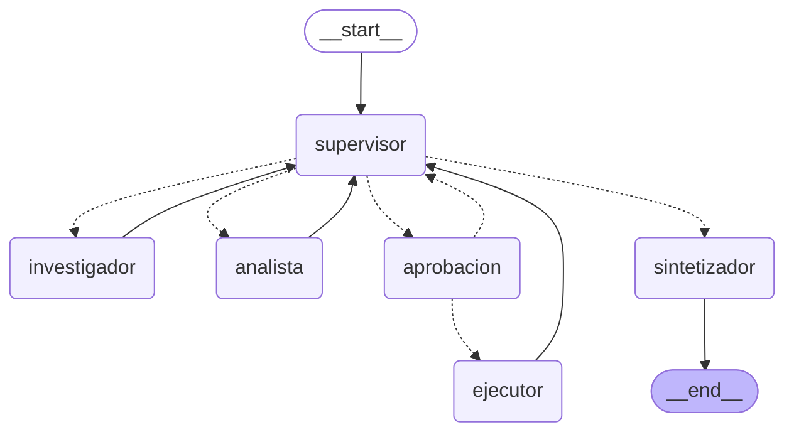
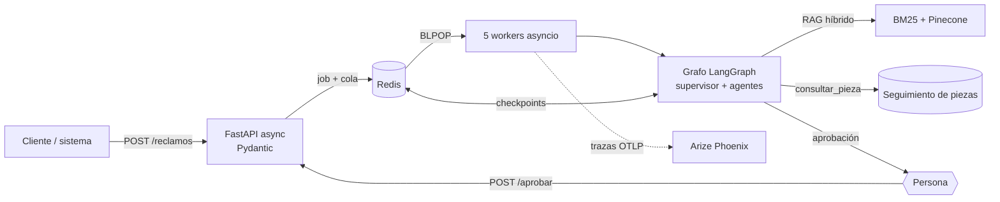
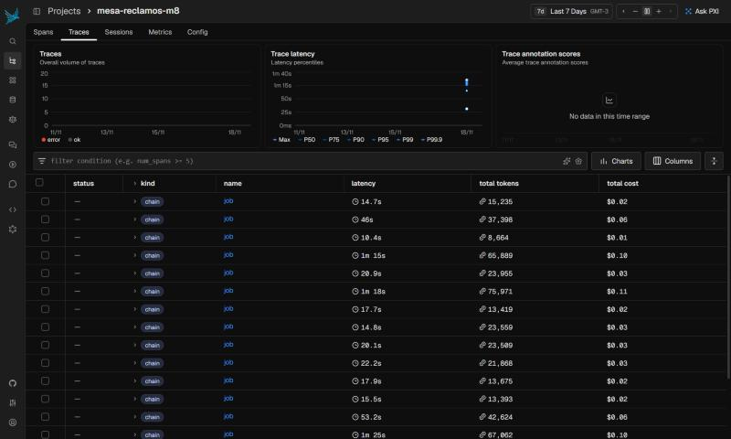
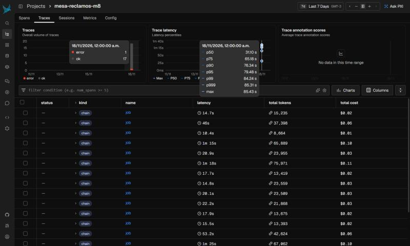

# Módulo 8 — Entrega final: Mesa de reclamos MailEx (*The Intelligence System*)

Sistema de IA de grado de producción que **atiende reclamos de clientes de una empresa de correo y logística**:
lee la normativa interna con **RAG híbrido**, verifica el estado real de la pieza con **agentes coordinados por un
supervisor**, propone la respuesta al cliente y el escalamiento, y **espera la aprobación de una persona** antes de
ejecutar nada. Todo detrás de una **API async documentada**, con el estado en **Redis** y cada ejecución trazada
en **Arize Phoenix**.

> Es la integración de los módulos anteriores: cliente async (M1), validación con Pydantic (M2), RAG (M3),
> RAG híbrido con Pinecone (M4), agente ReAct con LangGraph (M5), orquestador multi-agente (M6) y API de producción
> con Redis, trazas y human-in-the-loop (M7). Los datos son **sintéticos** (ningún cliente ni pieza real).

## Un reclamo, de punta a punta

```bash
curl -X POST http://localhost:8000/reclamos -H "Content-Type: application/json" -d '{
  "texto": "Esta carta documento a Neuquén no registra movimientos hace semanas. ¿Se perdió?",
  "pieza_id": "CD-100236", "cliente": "Constructora Andina SRL", "canal": "telefono"}'
# → 202 {"job_id": "…", "status": "PENDING"}   (responde al instante; los agentes trabajan en segundo plano)
```

1. **Investigador** (RAG híbrido): busca en la base de conocimiento el plazo de entrega de una carta documento a
   Patagonia (8 días hábiles), la política de presunción de extravío y la plantilla de respuesta.
2. **Analista**: consulta la pieza en el seguimiento (`consultar_pieza`) y calcula: 25 días hábiles desde la
   imposición, 17 de atraso, 23 sin movimientos → se cumple la presunción de extravío → escalar a Siniestros.
3. **Aprobación humana**: el grafo se **pausa** (`AWAITING_APPROVAL`). Lo propuesto se ve en
   `GET /reclamos/{id}`; mientras tanto la bandeja de salida está vacía.
4. `POST /reclamos/{id}/aprobar {"aprobado": true}` → el **ejecutor** responde al cliente con la plantilla y escala
   el caso; el **sintetizador** redacta el informe final con las fuentes y quién aportó cada dato.

## Diagrama del grafo de agentes



(Generado con `python scripts/generar_diagrama.py` desde el grafo compilado; también está en [`grafo.mmd`](grafo.mmd).
Las flechas punteadas son aristas condicionales.) **No existe ninguna flecha de `supervisor` a `ejecutor`**: la única
forma de llegar a la acción con efectos es pasar por `aprobacion`.

## Arquitectura



| Pieza | Qué hace | Archivo |
|---|---|---|
| API | Endpoints async, 202 + `job_id`, validación Pydantic, `/docs` | [`app/main.py`](app/main.py), [`app/schemas.py`](app/schemas.py) |
| Workers | Sacan jobs de Redis, corren el grafo, timeout y `FAILED` ante cualquier error | [`app/worker.py`](app/worker.py) |
| Estado y cola | Hash por job, cola FIFO, aprobación atómica (`WATCH`) | [`app/store.py`](app/store.py) |
| **Checkpointer** | `BaseCheckpointSaver` asíncrono sobre Redis: la conversación sobrevive a un reinicio | [`app/redis_checkpointer.py`](app/redis_checkpointer.py) |
| Grafo y supervisor | Supervisor con LLM + reglas en código (R0–R6) que impiden bucles y cierres en falso | [`app/graph.py`](app/graph.py), [`app/supervisor.py`](app/supervisor.py) |
| Aprobación humana | `interrupt()` + `Command(resume=…)` + `POST /reclamos/{id}/aprobar` | [`app/hitl.py`](app/hitl.py) |
| RAG híbrido | BM25 + Pinecone (cliente asyncio), fusión RRF, filtros por metadatos | [`app/rag/`](app/rag) |
| Agentes | Investigador (RAG), analista (seguimiento + cálculo), ejecutor (acciones) | [`app/agents/`](app/agents) |
| Observabilidad | Phoenix vía OpenInference: una traza por ejecución | [`app/observability.py`](app/observability.py) |

## Cómo se cumple cada requisito de la entrega

| Requisito | Dónde y cómo |
|---|---|
| **Integración de código (M6 + M7)** | Un único proyecto: orquestador del M6 + API/Redis/HITL del M7 + RAG del M4, bajo `app/`. |
| **Todo async** | Endpoints `async def`; LLM con `ainvoke`; Pinecone con `PineconeAsyncio`/`IndexAsyncio`; embeddings con `aembed_*`; Redis con `redis.asyncio`; herramientas `async def`; el repositorio de piezas lee el archivo con `asyncio.to_thread`. No hay `requests` ni llamadas bloqueantes dentro de corrutinas (BM25 es cómputo puro de microsegundos). |
| **Checkpointer de LangGraph** | `AsyncRedisCheckpointer` ([`app/redis_checkpointer.py`](app/redis_checkpointer.py)). El `thread_id` es el `job_id`. Se prueba con un grafo nuevo y un cliente Redis nuevo (simula reiniciar el servidor): [`tests/test_redis_y_hitl.py`](tests/test_redis_y_hitl.py) y la demostración real de abajo. |
| **Validación con Pydantic** | [`app/schemas.py`](app/schemas.py): cuerpo y respuesta de **cada endpoint**; **argumentos y resultados de cada herramienta de los agentes**; las piezas del seguimiento y los fragmentos del RAG. Campos desconocidos prohibidos (`extra="forbid"`), patrones (`CD-123456`), rangos, enumerados. |
| **Observabilidad (≥ 5 pruebas)** | 6 reclamos concurrentes + demos de aprobación y rechazo + reinicio, todos en Phoenix. Ver [Observabilidad](#observabilidad). |
| **README con diagrama del grafo** | Este archivo (diagrama de arriba). |
| **Despliegue local con una instrucción** | `docker compose up --build` o `./run.sh` / `.\run.ps1`. Ver [Cómo levantarlo](#cómo-levantarlo). |
| **Sin hard-coding** | Índice, namespace, modelos, proveedor, Redis, Phoenix, workers y timeouts salen de variables de entorno ([`.env.example`](.env.example), [`app/config.py`](app/config.py)). |

## Estructura

```
modulo-8-entrega-final/
├── app/
│   ├── main.py                 # API FastAPI (endpoints, lifespan, workers)
│   ├── schemas.py              # modelos Pydantic de API, herramientas y datos
│   ├── config.py               # configuración por variables de entorno
│   ├── graph.py · state.py · supervisor.py · hitl.py      # el grafo de agentes
│   ├── worker.py · store.py · redis_checkpointer.py       # ejecución, estado y persistencia (Redis)
│   ├── observability.py        # Phoenix / OpenInference
│   ├── calendario.py · tracking.py                        # días hábiles y seguimiento de piezas
│   ├── llm.py                  # fábrica de modelos de chat
│   ├── agents/                 # investigador · analista · ejecutor
│   └── rag/                    # chunking, ingesta, BM25 + Pinecone, fusión RRF
├── data/
│   ├── conocimiento/           # 14 documentos .md con metadatos (categoría, servicio, etiquetas)
│   └── piezas.json             # 20 piezas sintéticas de seguimiento
├── eval/golden_set.json        # 20 preguntas con su documento esperado
├── scripts/                    # ingestar · carga · demo_hitl · evaluar_rag · generar_*
├── tests/                      # 66 tests sin red ni cuenta de nada
├── screenshots/ · evidencia/   # capturas de Phoenix y resultados reales de las pruebas
├── docker-compose.yml · Dockerfile · run.sh · run.ps1 · .env.example
├── requirements*.txt · grafo.mmd
└── dev/redis_local.py          # Redis de DESARROLLO para equipos sin Docker
```

## Cómo levantarlo

Necesitás **Python 3.12+**, una API key del LLM (Anthropic u OpenAI), una cuenta de Pinecone (el plan gratuito
alcanza) y una key de embeddings (Gemini u OpenAI). Copiá `.env.example` a `.env` y completá las keys: **el `.env` real
nunca se sube al repositorio.**

```bash
cp .env.example .env          # y completá las keys
```

**Con Docker (una instrucción)** — levanta Redis, Phoenix, sube la base de conocimiento a Pinecone y arranca la API:

```bash
docker compose up --build
```

**Sin Docker (una instrucción)** — crea el entorno, instala, levanta Redis, ingesta y API:

```bash
./run.sh            # Linux / Mac / Git Bash
.\run.ps1           # Windows PowerShell
```

`run.sh` / `run.ps1` usan el Redis que ya esté en `REDIS_URL`; si no hay, levantan `redis-server`, Docker, o —en un
equipo sin ninguno— el servidor de desarrollo `dev/redis_local.py` (fakeredis; no persiste a disco). Para tener el
dashboard de trazas sin Docker: `python -m venv .venv-phoenix` e instalar `requirements-phoenix.txt` (la API arranca igual
sin Phoenix, solo que no envía trazas).

| Servicio | URL |
|---|---|
| API y documentación interactiva | http://localhost:8000/docs |
| Phoenix (trazas, costo, latencia) | http://localhost:6006 |

## Usar la API

| Endpoint | Qué hace |
|---|---|
| `POST /reclamos` | Valida el reclamo, lo guarda `PENDING` en Redis, lo encola y devuelve `202 {job_id}`. **No ejecuta el agente.** |
| `GET /reclamos/{job_id}` | Estado (`PENDING` · `RUNNING` · `AWAITING_APPROVAL` · `DONE` · `FAILED`), resultado, procedencia (qué agente aportó qué) y la acción pendiente de aprobación. |
| `POST /reclamos/{job_id}/aprobar` | `{"aprobado": true|false, "comentario": "…"}`. `404` si no existe, `409` si no está esperando aprobación. |
| `GET /bandeja` | Respuestas al cliente y escalamientos realizados (solo ocurren después de aprobar). |
| `POST /conocimiento/buscar` | Consulta directa al RAG híbrido con filtros (para depurar la recuperación). |
| `GET /salud` | Redis, modo del RAG, workers y largo de la cola. |

```bash
python scripts/demo_hitl.py                 # reclamo → pausa → el aprobador APRUEBA → acciones realizadas
python scripts/demo_hitl.py --rechazar      # el aprobador RECHAZA → no se envía ni escala nada
python scripts/demo_hitl.py --escenario 2   # otro caso (0..5 en scripts/escenarios.py)
```

### Los seis reclamos de ejemplo (`scripts/escenarios.py`)

| # | Pieza | Caso | Qué debería concluir |
|---|---|---|---|
| 0 | `CD-100231` | Carta documento en AMBA, 5 días hábiles de 3 permitidos; el cliente avisa de un vencimiento legal | Demora → escalar (urgente, Legales) |
| 1 | `CD-100234` | Entregada hace 9 días hábiles, acuse sin devolver (plazo 5) | Acuse pendiente → Distribución |
| 2 | `CD-100236` | Patagonia, 23 días hábiles sin movimientos | Presunto extravío → Siniestros |
| 3 | `EN-204519` | Encomienda al interior, 8 días hábiles de 5 | Demora → Coordinación Interior |
| 4 | `NT-310077` | Notificación de cliente corporativo con penalidad | Demora + Atención Corporativa |
| 5 | `EN-204518` | Encomienda impuesta ayer | Dentro del plazo: solo informar |

## Aprobación humana (human-in-the-loop)

La respuesta al cliente y el escalamiento son **acciones con efectos**, así que **ningún camino del grafo llega al
ejecutor sin pasar por `aprobacion`** (el test `test_el_ejecutor_no_se_alcanza_sin_pasar_por_la_aprobacion` lo verifica
sobre las aristas del grafo compilado). El nodo llama a `interrupt()`: LangGraph guarda el checkpoint en Redis y el
worker queda libre. Al aprobar, el job se reencola y se reanuda con `Command(resume=…)`; al rechazar, el supervisor
cierra informando que **no se realizó ninguna acción** y no puede insistir (regla R5). Dos aprobaciones simultáneas del mismo
reclamo reanudan **una sola vez** (transición atómica con `WATCH`).

Reglas del supervisor, en código y verificadas por tests: **R1** tope de pasos · **R2** el analista nunca antes que el
investigador · **R3** límite de refinamientos (avanza al paso que falta, no cierra en falso) · **R4** puertas de calidad
antes de cerrar (fuentes citadas, herramientas usadas) · **R5** la acción es única, exige datos previos y no se repite
tras un rechazo · **R6** en la mesa de reclamos no se cierra sin proponer la acción (un rechazo cuenta como resuelta).

## RAG híbrido

- **Corpus**: 14 documentos `.md` (procedimientos, plazos, políticas, escalamiento, plantillas) con metadatos
  `categoria`, `servicio` y `etiquetas`. Se parten **por sección `##`** (81 fragmentos), de modo que la cita
  `archivo#sección` apunta exactamente a lo leído.
- **Recuperación**: BM25 (términos exactos, códigos) + Pinecone (significado), fusionados con **Reciprocal Rank
  Fusion** ponderada (0,4 / 0,6). Un fragmento que ven los dos recuperadores suma ambos aportes.
- **Metadatos**: filtros por `categoria` y `servicio` aplicados en BM25 **y** en Pinecone (`$eq`, `$in`, `$and`); el filtro
  de servicio incluye siempre los documentos generales.
- **Ingesta idempotente** (`scripts/ingestar.py`): una huella del contenido y de los parámetros decide si hay que volver a
  subir; es reanudable y verifica que índice y consulta usen el mismo modelo de embeddings.

### Evaluación de la recuperación

`python scripts/evaluar_rag.py --k 1` contra el *golden set* ([`eval/golden_set.json`](eval/golden_set.json): 20
preguntas, 14 directas y 6 difíciles —paráfrasis sin palabras clave y consultas de solo términos—). Un acierto es que
el documento esperado aparezca en el top-k. Resultado real contra Pinecone:

| Estrategia | Recall@1 | Recall@3 | MRR@3 |
|---|---|---|---|
| Solo léxica (BM25) | 0,80 | 0,95 | 0,867 |
| Solo semántica (Pinecone) | 0,95 | 1,00 | 0,975 |
| **Híbrida (RRF)** | **0,95** | **1,00** | **0,975** |

Lectura honesta: el corpus es chico (14 documentos) y las preguntas directas las resuelven las tres estrategias; BM25
falla en las paráfrasis («mi paquete desapareció…») y el híbrido las recupera sin perder los términos exactos, pero **empata
con la semántica pura** en este *golden set*: no demuestra una ventaja sobre ella, solo que no pierde nada.

## Observabilidad

Cada ejecución del grafo es **una traza** en Arize Phoenix (proyecto `mesa-reclamos-m8`): un span raíz `job` que
contiene el árbol completo —supervisor, cada agente, cada llamada al LLM con sus tokens y cada herramienta con su
entrada y salida—. Un reclamo que pasa por la aprobación genera **dos trazas** (la corrida hasta la pausa y la
reanudación). La latencia por traza es entonces por tramo; la de punta a punta, medida por el cliente, está más abajo.

### Las pruebas (18 trazas, 9 reclamos reales con el modelo `claude-haiku-4-5`)

| Prueba | Qué hace | Resultado |
|---|---|---|
| 6 reclamos **concurrentes** (`scripts/carga.py --n 6`) | los seis casos de la tabla de arriba a la vez, con aprobación automática | 6/6 `DONE` |
| Aprobación (`demo_hitl.py --escenario 2`) | extravío en Patagonia: pausa → aprobar | `DONE`, **2 acciones** (respuesta + escalamiento a Siniestros) |
| Rechazo (`demo_hitl.py --rechazar --escenario 3`) | encomienda demorada: pausa → rechazar | `DONE`, **0 acciones**, informe aclara que no se hizo nada |
| Reinicio (`demo_reinicio.py`) | reclamo pausado → se mata y relanza la API → se aprueba | sigue `AWAITING_APPROVAL` desde Redis y termina `DONE` |

Salidas completas en [`evidencia/`](evidencia).

### Latencia y costo (de Phoenix)

| Métrica | Valor |
|---|---|
| Latencia por traza P50 / P95 / P99 | 31,1 s / **79,5 s** / 84,2 s |
| Costo total de las 18 trazas | **$0,91** (621.432 tokens) |
| Costo por ejecución (traza) | de $0,01 a $0,11 (ver captura 02) |
| Costo medio por reclamo (2 trazas) | ≈ $0,10 |

Medido por el cliente en la prueba de carga (reclamo completo: investigar + analizar + esperar la aprobación + ejecutar +
sintetizar): **p50 93,2 s, p95 111,3 s**, los 6 en paralelo en 111,3 s de pared (no 6 × 90 s), `evidencia/carga.json`.

Capturas ([`screenshots/`](screenshots)): `01` proyecto y trazas · `02` **costo y latencia por ejecución** ·
`03` **latencia P50/P95** (tooltip del gráfico) · `04` herramientas de los agentes con sus entradas y salidas.




Notas sobre lo que se ve en el dashboard:

- **Una traza figura con error.** Es el supervisor devolviendo su decisión sin el campo obligatorio `siguiente`
  (`ValidationError` de Pydantic). El decisor **reintenta una vez** y la ejecución terminó bien; queda visible a propósito.
- Phoenix muestra P50 y P99 en la cabecera del proyecto; el **P95** está en el tooltip del gráfico *Trace latency*.
- Hubo un problema de medición que se corrigió antes de las capturas finales: el SDK de Anthropic emite sus propios spans
  con los mismos tokens que ya reporta LangChain y Phoenix los sumaba dos veces (tokens y costo ×2). Se desactivan con
  `ANTHROPIC_OPEN_TELEMETRY=false` antes de crear el cliente del modelo ([`app/config.py`](app/config.py)); con la
  corrección el costo total bajó de ≈ $1,76 a $0,91 para una carga equivalente.
- Alternativa **LangSmith**: no requiere código; `LANGSMITH_TRACING=true` y `LANGSMITH_API_KEY` en el entorno.

## Pruebas automáticas

```bash
pip install -r requirements.txt -r requirements-dev.txt
pytest          # 66 tests, ~10 s, sin red ni cuentas (Redis falso, LLM de guion, Pinecone de juguete)
```

Cubren: el grafo y las reglas del supervisor (R0–R6), el checkpointer y la reanudación tras un reinicio, la aprobación
(aprobar, rechazar, concurrencia), la API (202, 404, 409, 422, `FAILED`, timeout, 5 peticiones concurrentes, jobs
huérfanos), el RAG (chunking, BM25, RRF, filtros, ids desactualizados) y las herramientas con sus esquemas.

## Decisiones de diseño y límites

**Decisiones**

- **Supervisor con reglas en código, no solo con LLM.** Un modelo pequeño se equivoca (omitió campos, insistió con el
  mismo agente, cerró sin analizar). Las reglas R0–R6 garantizan que siempre se llegue al cierre y que nunca se salte el
  diagnóstico ni la acción; cada decisión queda registrada con la regla que la corrigió.
- **Checkpointer propio sobre Redis estándar** (`AsyncRedisCheckpointer`) en vez del `RedisSaver` oficial, que exige
  Redis Stack (módulos de búsqueda/JSON). Funciona con la imagen `redis:7-alpine`.
- **Seguimiento de piezas simulado** detrás de un repositorio asíncrono: cambiarlo por una base real es reemplazar una clase.
- **"Hoy" fijo** (`HOY_SIMULADO`) para que los datos sintéticos y las demos sean reproducibles.
- **BM25 en el proceso** (índice de 81 fragmentos reconstruido desde los `.md`) y los vectores en Pinecone; al arrancar se
  avisa si ambos no coinciden.

**Límites, dichos sin rodeos**

- **Redis real no probado en esta máquina.** No hay Docker ni WSL, así que todas las pruebas con el servidor corriendo
  usaron `dev/redis_local.py` (fakeredis). El código solo usa comandos estándar y `docker-compose.yml` levanta `redis:7`,
  pero **no lo ejecuté contra un Redis real**. Del mismo modo, `docker-compose.yml` y `run.sh` están escritos y no
  ejecutados (`run.ps1` sí, de punta a punta).
- **`POST /reclamos` tarda hasta ~2 s cuando entran varios reclamos a la vez.** Con una sola petición responde en
  10 ms y un endpoint sin Redis responde en 10–20 ms con 6 concurrentes; midiendo el event loop del proceso no vi
  bloqueos mayores a 0,3 s. Sospecho del servidor de Redis simulado (un proceso Python que atiende a los 5 workers y a la
  API), pero **no lo comprobé contra un Redis real**.
- **Latencia alta:** un reclamo tarda 60–110 s. Casi todo es el investigador (varias búsquedas con el LLM) y las vueltas
  del supervisor; no está optimizado.
- **La calidad depende del modelo.** `claude-haiku-4-5` a veces elige el área de escalamiento menos precisa (p. ej.
  Distribución para una pieza del interior cuando la política dice Coordinación Interior); por eso hay aprobación humana
  antes de cualquier acción.
- **Sin autenticación** en `/aprobar` ni en el resto de la API: cualquiera con acceso a la red podría aprobar. En
  producción iría detrás de un gateway con identidad y registro de quién aprobó.
- **Envío simulado:** la "respuesta al cliente" y el "escalamiento" se registran en una bandeja de salida; no sale ningún
  mail real.
- **El golden set del RAG es chico** (20 preguntas, mismo autor que el corpus): sirve para detectar regresiones, no para
  afirmar un rendimiento general.

## Contenido de la carpeta de evidencia

- `screenshots/` — capturas de Phoenix (proyecto, trazas con costo y latencia, p95, árbol de una traza).
- `evidencia/carga.json` — resultado de los 6 reclamos concurrentes (tiempos, flujo de cada uno).
- `evidencia/hitl_aprobado.txt`, `evidencia/hitl_rechazado.txt` — salida de `scripts/demo_hitl.py`.
- `evidencia/reinicio.txt` — el reclamo que sobrevive al reinicio del servidor.
